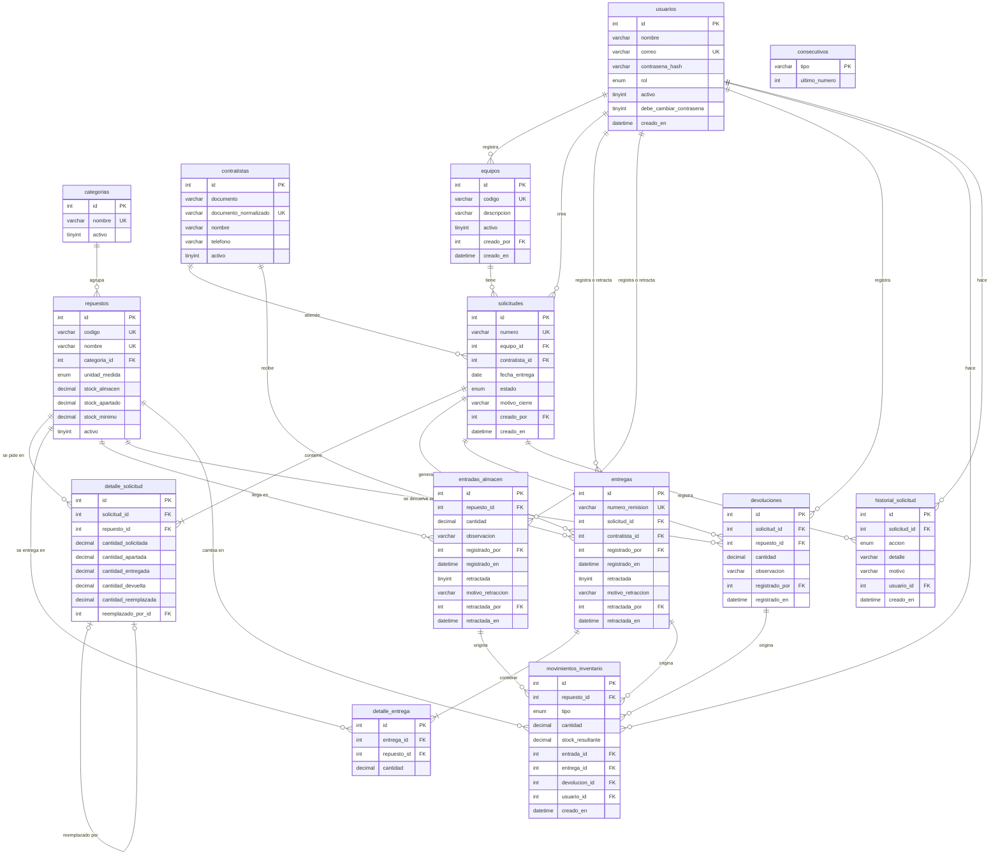

# Modelo de datos FacturApp

Base de datos: **MySQL 8 (AppServ) o MariaDB (XAMPP)**. Todas las tablas usan el motor **InnoDB**, que permite transacciones y llaves foráneas, y la colación `utf8mb4_unicode_ci`, que funciona en ambos motores y hace que "Válvulas" y "valvulas" se consideren el mismo texto (RN-07).

Convenciones:

- Nombres en español, en minúscula, con guion bajo y sin tildes ni ñ (RNF-26).
- Cada tabla tiene una llave primaria `id` numérica y autoincremental, excepto `consecutivos`.
- Ninguna llave foránea permite borrar un registro que ya se usó (`ON DELETE RESTRICT`): los datos se desactivan o se retractan, no se borran (RN-05, RN-26).
- Las referencias RN y RNF corresponden a `02-requisitos.md`; las PA son preguntas abiertas de ese mismo documento.

## 1. Resumen de tablas

| # | Tabla | Qué guarda |
|---|---|---|
| 1 | `usuarios` | Las personas que entran al sistema, con su rol, si están activas y si deben cambiar la contraseña. |
| 2 | `categorias` | Las categorías que agrupan los repuestos. |
| 3 | `repuestos` | El catálogo de repuestos, con su unidad de medida y su stock en almacén y apartado. |
| 4 | `contratistas` | Los técnicos o empresas que reciben los repuestos, identificados por cédula o NIT. |
| 5 | `equipos` | Las neveras que se reparan, identificadas por su código. |
| 6 | `solicitudes` | Cada solicitud de repuestos: equipo, contratista, fecha de entrega y estado. |
| 7 | `detalle_solicitud` | Los repuestos de cada solicitud, con lo solicitado, apartado, entregado, devuelto y reemplazado. |
| 8 | `entregas` | Cada entrega de repuestos; cada fila es una remisión con su número único. |
| 9 | `detalle_entrega` | Los repuestos y cantidades de cada entrega. |
| 10 | `entradas_almacen` | La mercancía que llega al almacén. |
| 11 | `devoluciones` | Los repuestos que el contratista devuelve sin usar. |
| 12 | `movimientos_inventario` | Cada cambio de stock, con el stock que quedó después. |
| 13 | `historial_solicitud` | La línea de tiempo de cada solicitud: qué pasó, quién y cuándo. |
| 14 | `consecutivos` | El último número usado de solicitudes (SOL) y remisiones (REM). |

## 2. Diagrama entidad-relación

La tabla `consecutivos` no tiene relaciones: solo guarda contadores.

## 3. Diccionario de datos

**Abreviaturas:** PK = llave primaria; FK = llave foránea (apunta a otra tabla); UNIQUE = el valor no se puede repetir.

### 3.1 `usuarios`

| Columna | Tipo | Nulo | Llave | Descripción |
|---|---|:---:|:---:|---|
| id | INT UNSIGNED AUTO_INCREMENT | No | PK | Identificador del usuario. |
| nombre | VARCHAR(100) | No | | Nombre de la persona. |
| correo | VARCHAR(150) | No | UNIQUE | Correo con el que inicia sesión (PA-01). |
| contrasena_hash | VARCHAR(255) | No | | Contraseña cifrada con bcrypt; nunca en texto plano (RNF-01). |
| rol | ENUM('admin','oficina') | No | | Rol: Admin u Oficina radicadora. |
| activo | TINYINT(1), por defecto 1 | No | | 1 = puede entrar; 0 = desactivado (RN-01, RN-32). |
| debe_cambiar_contrasena | TINYINT(1), por defecto 0 | No | | 1 = tiene contraseña temporal y debe cambiarla al entrar (RN-04). |
| creado_en | DATETIME, por defecto la fecha actual | No | | Fecha y hora de creación. |

### 3.2 `categorias`

| Columna | Tipo | Nulo | Llave | Descripción |
|---|---|:---:|:---:|---|
| id | INT UNSIGNED AUTO_INCREMENT | No | PK | Identificador de la categoría. |
| nombre | VARCHAR(80) | No | UNIQUE | Nombre de la categoría; no se repite (RN-07). |
| activo | TINYINT(1), por defecto 1 | No | | 1 = activa; 0 = desactivada (RN-05, RN-06). |

### 3.3 `repuestos`

| Columna | Tipo | Nulo | Llave | Descripción |
|---|---|:---:|:---:|---|
| id | INT UNSIGNED AUTO_INCREMENT | No | PK | Identificador del repuesto. |
| codigo | VARCHAR(30) | No | UNIQUE | Código, por ejemplo VAL-001; no se repite (RN-07). Los caracteres permitidos (letras sin tildes, números y guiones) los valida el backend (RN-25). |
| nombre | VARCHAR(120) | No | UNIQUE | Nombre del repuesto; no se repite (RN-07). |
| categoria_id | INT UNSIGNED | No | FK → categorias | Categoría a la que pertenece. |
| unidad_medida | ENUM('unidad','metro','litro','kilogramo') | No | | Cómo se cuenta el repuesto (RN-12, PA-04). |
| stock_almacen | DECIMAL(12,2), por defecto 0 | No | | Lo que hay físicamente en el almacén. CHECK: ≥ 0 (RN-10). |
| stock_apartado | DECIMAL(12,2), por defecto 0 | No | | Lo reservado para solicitudes abiertas. CHECK: entre 0 y `stock_almacen` (RN-13, RN-27). |
| stock_minimo | DECIMAL(12,2) | Sí | | Nivel para la alerta de stock bajo (fase 2). CHECK: ≥ 0 (RN-24). |
| activo | TINYINT(1), por defecto 1 | No | | 1 = activo; 0 = desactivado (RN-05, RN-34). |

**Datos calculados (no se guardan):** stock disponible = `stock_almacen` − `stock_apartado`. Lo que está en espera se calcula con `detalle_solicitud`.

### 3.4 `contratistas`

| Columna | Tipo | Nulo | Llave | Descripción |
|---|---|:---:|:---:|---|
| id | INT UNSIGNED AUTO_INCREMENT | No | PK | Identificador del contratista. |
| documento | VARCHAR(20) | No | | Cédula o NIT tal como se escribió, por ejemplo 900.123.456-7 (RN-25). |
| documento_normalizado | VARCHAR(20) | No | UNIQUE | El documento solo con dígitos, por ejemplo 9001234567, para evitar repetidos (RN-08). |
| nombre | VARCHAR(120) | No | | Nombre; se aceptan homónimos. |
| telefono | VARCHAR(20) | Sí | | Teléfono de contacto (PA-10). |
| activo | TINYINT(1), por defecto 1 | No | | 1 = activo; 0 = desactivado (RN-05, RN-31). |

### 3.5 `equipos`

Tabla provisional hasta responder PA-27 (datos del equipo).

| Columna | Tipo | Nulo | Llave | Descripción |
|---|---|:---:|:---:|---|
| id | INT UNSIGNED AUTO_INCREMENT | No | PK | Identificador del equipo. |
| codigo | VARCHAR(30) | No | UNIQUE | Código de la nevera; no se repite. Los caracteres permitidos los valida el backend (RN-25). |
| descripcion | VARCHAR(150) | Sí | | Marca, modelo o ubicación, mientras se define PA-27. |
| activo | TINYINT(1), por defecto 1 | No | | 1 = activo; 0 = desactivado (RN-05). |
| creado_por | INT UNSIGNED | No | FK → usuarios | Usuario que lo registró. |
| creado_en | DATETIME, por defecto la fecha actual | No | | Fecha y hora de registro. |

### 3.6 `solicitudes`

| Columna | Tipo | Nulo | Llave | Descripción |
|---|---|:---:|:---:|---|
| id | INT UNSIGNED AUTO_INCREMENT | No | PK | Identificador de la solicitud. |
| numero | VARCHAR(12) | No | UNIQUE | Número visible, por ejemplo SOL-000045 (PA-06). |
| equipo_id | INT UNSIGNED | No | FK → equipos | Nevera que se repara (RN-14). |
| contratista_id | INT UNSIGNED | No | FK → contratistas | Contratista actual; puede reasignarse (RN-14, RN-31). |
| fecha_entrega | DATE | No | | Fecha en que se espera entregar los repuestos (RN-14, PA-07). |
| estado | ENUM('abierta','reparado','devuelto','anulada'), por defecto 'abierta' | No | | Estado de la solicitud (RN-22, PA-05). |
| motivo_cierre | VARCHAR(255) | Sí | | Motivo de la devolución o de la anulación. CHECK: obligatorio si el estado es 'devuelto' o 'anulada' (RN-23, RN-29). |
| creado_por | INT UNSIGNED | No | FK → usuarios | Usuario que la creó (RN-20). |
| creado_en | DATETIME, por defecto la fecha actual | No | | Fecha y hora de creación (RN-20). |

**Dato calculado (no se guarda):** el estado de la entrega ("Pendiente", "Parcial" o "Completa") se calcula con `detalle_solicitud` (RN-21).

**Al reabrir una solicitud (HU-35):** el backend deja `motivo_cierre` vacío (NULL); el motivo del cierre anterior y el de la reapertura quedan en `historial_solicitud`.

**Índice:** `ix_solicitudes_estado` sobre `estado`, para que los listados filtren rápido (RNF-19).

### 3.7 `detalle_solicitud`

| Columna | Tipo | Nulo | Llave | Descripción |
|---|---|:---:|:---:|---|
| id | INT UNSIGNED AUTO_INCREMENT | No | PK | Identificador de la fila. |
| solicitud_id | INT UNSIGNED | No | FK → solicitudes | Solicitud a la que pertenece. |
| repuesto_id | INT UNSIGNED | No | FK → repuestos | Repuesto pedido. UNIQUE junto con `solicitud_id`: un repuesto no se repite en la misma solicitud (RN-15). |
| cantidad_solicitada | DECIMAL(12,2) | No | | Cantidad pedida originalmente; no cambia al reemplazar. CHECK: > 0 (RN-11). |
| cantidad_apartada | DECIMAL(12,2), por defecto 0 | No | | Cantidad reservada en este momento (RN-13, RN-33). CHECK: ≥ 0. |
| cantidad_entregada | DECIMAL(12,2), por defecto 0 | No | | Suma de las entregas vigentes. CHECK: ≥ 0 y ≤ `cantidad_solicitada` − `cantidad_reemplazada` (RN-16). |
| cantidad_devuelta | DECIMAL(12,2), por defecto 0 | No | | Cantidad devuelta sin usar. CHECK: ≥ 0 y ≤ `cantidad_entregada` (RN-28). |
| cantidad_reemplazada | DECIMAL(12,2), por defecto 0 | No | | Cantidad que se pasó a otro repuesto al reemplazar este (HU-37, RN-34). CHECK: ≥ 0. |
| reemplazado_por_id | INT UNSIGNED | Sí | FK → detalle_solicitud | Fila del repuesto que reemplazó a este (HU-37, RN-34). CHECK: obligatoria si `cantidad_reemplazada` > 0. |

**Restricción adicional:** CHECK `cantidad_apartada` + `cantidad_entregada` + `cantidad_reemplazada` ≤ `cantidad_solicitada`.

**Dato calculado (no se guarda):** en espera = `cantidad_solicitada` − `cantidad_reemplazada` − `cantidad_entregada` − `cantidad_apartada`. Solo cuenta en solicitudes abiertas (RN-33).

**Ejemplo de reemplazo (HU-37):** una fila pidió 4 válvulas VAL-001, se entregaron 2 y las otras 2 quedaron en espera; VAL-001 se desactiva sin stock. Al reemplazarla, esta fila queda con `cantidad_solicitada` = 4 (lo que se pidió), `cantidad_entregada` = 2 y `cantidad_reemplazada` = 2, y se crea una fila nueva con el repuesto de reemplazo y cantidad 2.

### 3.8 `entregas`

Cada fila es una entrega y su remisión.

| Columna | Tipo | Nulo | Llave | Descripción |
|---|---|:---:|:---:|---|
| id | INT UNSIGNED AUTO_INCREMENT | No | PK | Identificador de la entrega. |
| numero_remision | VARCHAR(12) | No | UNIQUE | Número de remisión, por ejemplo REM-000124; no se repite, no se salta ni se reutiliza (RN-18). |
| solicitud_id | INT UNSIGNED | No | FK → solicitudes | Solicitud a la que pertenece. |
| contratista_id | INT UNSIGNED | No | FK → contratistas | Contratista que recibió en ese momento; no cambia si la solicitud se reasigna (RN-31). |
| registrado_por | INT UNSIGNED | No | FK → usuarios | Admin que registró la entrega (RN-20). |
| registrado_en | DATETIME, por defecto la fecha actual | No | | Fecha y hora de la entrega (RN-20). |
| retractada | TINYINT(1), por defecto 0 | No | | 1 = la entrega fue retractada (HU-31). |
| motivo_retraccion | VARCHAR(255) | Sí | | Motivo de la retracción. |
| retractada_por | INT UNSIGNED | Sí | FK → usuarios | Admin que la retractó. |
| retractada_en | DATETIME | Sí | | Fecha y hora de la retracción. |

**Restricción adicional:** CHECK: si `retractada` = 1, son obligatorios `motivo_retraccion` (no vacío), `retractada_por` y `retractada_en` (RN-26).

### 3.9 `detalle_entrega`

| Columna | Tipo | Nulo | Llave | Descripción |
|---|---|:---:|:---:|---|
| id | INT UNSIGNED AUTO_INCREMENT | No | PK | Identificador de la fila. |
| entrega_id | INT UNSIGNED | No | FK → entregas | Entrega a la que pertenece. |
| repuesto_id | INT UNSIGNED | No | FK → repuestos | Repuesto entregado. UNIQUE junto con `entrega_id`. |
| cantidad | DECIMAL(12,2) | No | | Cantidad entregada. CHECK: > 0 (RN-11). |

### 3.10 `entradas_almacen`

| Columna | Tipo | Nulo | Llave | Descripción |
|---|---|:---:|:---:|---|
| id | INT UNSIGNED AUTO_INCREMENT | No | PK | Identificador de la entrada. |
| repuesto_id | INT UNSIGNED | No | FK → repuestos | Repuesto que llegó. |
| cantidad | DECIMAL(12,2) | No | | Cantidad que llegó. CHECK: > 0 (RN-11). |
| observacion | VARCHAR(255) | Sí | | Nota opcional; puede incluir el número de factura (PA-11). |
| registrado_por | INT UNSIGNED | No | FK → usuarios | Admin que la registró. |
| registrado_en | DATETIME, por defecto la fecha actual | No | | Fecha y hora de registro. |
| retractada | TINYINT(1), por defecto 0 | No | | 1 = la entrada fue retractada (HU-32). |
| motivo_retraccion | VARCHAR(255) | Sí | | Motivo de la retracción. |
| retractada_por | INT UNSIGNED | Sí | FK → usuarios | Admin que la retractó. |
| retractada_en | DATETIME | Sí | | Fecha y hora de la retracción. |

**Restricción adicional:** CHECK: si `retractada` = 1, son obligatorios `motivo_retraccion` (no vacío), `retractada_por` y `retractada_en` (RN-26).

### 3.11 `devoluciones`

| Columna | Tipo | Nulo | Llave | Descripción |
|---|---|:---:|:---:|---|
| id | INT UNSIGNED AUTO_INCREMENT | No | PK | Identificador de la devolución. |
| solicitud_id | INT UNSIGNED | No | FK → solicitudes | Solicitud de la que vuelven los repuestos. |
| repuesto_id | INT UNSIGNED | No | FK → repuestos | Repuesto devuelto. |
| cantidad | DECIMAL(12,2) | No | | Cantidad devuelta. CHECK: > 0 (RN-11, RN-28). |
| observacion | VARCHAR(255) | Sí | | Nota opcional. |
| registrado_por | INT UNSIGNED | No | FK → usuarios | Admin que la registró. |
| registrado_en | DATETIME, por defecto la fecha actual | No | | Fecha y hora de registro. |

### 3.12 `movimientos_inventario`

| Columna | Tipo | Nulo | Llave | Descripción |
|---|---|:---:|:---:|---|
| id | INT UNSIGNED AUTO_INCREMENT | No | PK | Identificador del movimiento. |
| repuesto_id | INT UNSIGNED | No | FK → repuestos | Repuesto cuyo stock cambió. |
| tipo | ENUM('entrada','entrega','devolucion','retraccion_entrada','retraccion_entrega') | No | | Qué causó el movimiento (RN-09). |
| cantidad | DECIMAL(12,2) | No | | Positiva si el stock sube y negativa si baja. CHECK: ≠ 0. |
| stock_resultante | DECIMAL(12,2) | No | | Stock en almacén después del movimiento. CHECK: ≥ 0 (RN-10, HU-27). |
| entrada_id | INT UNSIGNED | Sí | FK → entradas_almacen | Entrada que lo originó, si aplica. |
| entrega_id | INT UNSIGNED | Sí | FK → entregas | Entrega que lo originó, si aplica. |
| devolucion_id | INT UNSIGNED | Sí | FK → devoluciones | Devolución que lo originó, si aplica. |
| usuario_id | INT UNSIGNED | No | FK → usuarios | Usuario que hizo la acción (RN-20). |
| creado_en | DATETIME, por defecto la fecha actual | No | | Fecha y hora del movimiento (RN-20). |

**Restricción adicional:** CHECK: cada tipo debe indicar su origen. Los tipos 'entrada' y 'retraccion_entrada' exigen `entrada_id`; 'entrega' y 'retraccion_entrega' exigen `entrega_id`; 'devolucion' exige `devolucion_id`.

### 3.13 `historial_solicitud`

| Columna | Tipo | Nulo | Llave | Descripción |
|---|---|:---:|:---:|---|
| id | INT UNSIGNED AUTO_INCREMENT | No | PK | Identificador del registro. |
| solicitud_id | INT UNSIGNED | No | FK → solicitudes | Solicitud afectada. |
| accion | ENUM('creada','editada','entrega','retraccion_entrega','devolucion','reparado','devuelto','anulada','reabierta','contratista_reasignado','repuesto_reemplazado') | No | | Qué pasó. |
| detalle | VARCHAR(255) | Sí | | Valor anterior y nuevo, o la remisión relacionada. |
| motivo | VARCHAR(255) | Sí | | Motivo de la acción. |
| usuario_id | INT UNSIGNED | No | FK → usuarios | Usuario que hizo la acción (RN-20). |
| creado_en | DATETIME, por defecto la fecha actual | No | | Fecha y hora de la acción (RN-20). |

**Restricción adicional:** CHECK: las acciones 'retraccion_entrega', 'devuelto', 'anulada' y 'reabierta' exigen `motivo` no vacío (RN-23, RN-26, RN-29, RN-30).

**Varios cambios a la vez:** si una edición cambia varios datos (por ejemplo, tres repuestos), el backend guarda una fila de historial por cada cambio, para que `detalle` nunca supere los 255 caracteres.

### 3.14 `consecutivos`

| Columna | Tipo | Nulo | Llave | Descripción |
|---|---|:---:|:---:|---|
| tipo | VARCHAR(10) | No | PK | Tipo de número: 'SOL' (solicitudes) o 'REM' (remisiones). |
| ultimo_numero | INT UNSIGNED, por defecto 0 | No | | Último número usado. Se bloquea con `SELECT ... FOR UPDATE` dentro de la transacción para que no se repita ni se salte (RN-18). |

## 4. Relaciones

1. Una **categoría** agrupa muchos **repuestos**, y cada repuesto pertenece a una sola categoría.
2. Un **equipo** puede tener muchas **solicitudes** a lo largo del tiempo, y cada solicitud es para un solo equipo.
3. Un **contratista** puede tener muchas **solicitudes**, y cada solicitud tiene un solo contratista en cada momento.
4. Un **contratista** recibe muchas **entregas**, y cada entrega queda a nombre del contratista que la recibió.
5. Una **solicitud** contiene uno o más repuestos en su **detalle**, y cada fila del detalle pertenece a una sola solicitud.
6. Un **repuesto** puede pedirse en muchas solicitudes, pero solo una vez en cada solicitud.
7. Una fila del **detalle de la solicitud** puede ser reemplazada por otra fila cuando su repuesto se desactiva sin stock.
8. Una **solicitud** puede tener muchas **entregas**, y cada entrega es una **remisión** de una sola solicitud.
9. Una **entrega** contiene uno o más repuestos en su **detalle**.
10. Un **repuesto** puede llegar en muchas **entradas al almacén**.
11. Una **solicitud** puede recibir muchas **devoluciones**, y cada devolución es de un solo repuesto.
12. Cada **entrada, entrega, devolución o retracción** deja uno o más **movimientos de inventario** del repuesto afectado.
13. Cada acción sobre una **solicitud** deja un registro en su **historial**.
14. Un **usuario** registra equipos, crea solicitudes, registra o retracta entregas y entradas, y registra devoluciones; cada acción queda a su nombre.

**Limitaciones del diagrama:** Mermaid no permite marcar los UNIQUE de dos columnas: (`solicitud_id`, `repuesto_id`) en `detalle_solicitud` y (`entrega_id`, `repuesto_id`) en `detalle_entrega`. Además, "una solicitud tiene uno o más repuestos" no lo impone la base de datos: lo exige el backend (RN-15).

## 5. Qué protege la base de datos y qué protege el backend

### 5.1 Reglas que la base de datos protege por completo

| Regla | Cómo |
|---|---|
| RN-08 Cédula o NIT único | UNIQUE sobre `documento_normalizado` (el backend calcula el valor normalizado). |
| RN-10 Stock nunca negativo | CHECK `stock_almacen` ≥ 0 y `stock_resultante` ≥ 0. |
| RN-11 Cantidades mayores que cero | CHECK > 0 en solicitudes, entradas, entregas y devoluciones. |
| RN-16 No entregar de más | CHECK `cantidad_entregada` ≤ `cantidad_solicitada` − `cantidad_reemplazada`. |
| RN-23 Motivo al devolver | CHECK sobre `motivo_cierre`. |
| RN-24 Stock mínimo no negativo | CHECK `stock_minimo` ≥ 0. |
| RN-27 No retractar una entrada ya usada | CHECK `stock_apartado` ≤ `stock_almacen`. |
| RN-28 No devolver de más | CHECK `cantidad_devuelta` ≤ `cantidad_entregada`. |

### 5.2 Reglas compartidas

| Regla | La base de datos | El backend |
|---|---|---|
| RN-05 No borrar, desactivar | FK con `ON DELETE RESTRICT` | Ofrecer "Desactivar" y ocultar los inactivos en operaciones nuevas |
| RN-07 Nombres y códigos únicos | UNIQUE con colación que ignora mayúsculas y tildes | Quitar espacios al inicio y al final |
| RN-13 Stock apartado | CHECK de cantidades en `detalle_solicitud` | Calcular cuánto apartar |
| RN-14 Datos de la solicitud | NOT NULL + FK de equipo y contratista | Fecha de entrega no anterior a hoy |
| RN-15 Repuestos de la solicitud | UNIQUE (solicitud, repuesto) | Al menos un repuesto |
| RN-18 Numeración | UNIQUE del número | `SELECT ... FOR UPDATE` en `consecutivos`, dentro de una transacción |
| RN-19 Remisión inalterable | Las FK impiden borrarla | Impedir que se edite |
| RN-20 Fecha y usuario | `DEFAULT CURRENT_TIMESTAMP` | Guardar el usuario |
| RN-26 Retracciones | CHECK de motivo, quién y cuándo | Solo el Admin |
| RN-29 y RN-30 Anular y reabrir | CHECK de motivo | Sin entregas vigentes; solo el Admin; una anulada no se reabre |
| RN-34 Reemplazo | CHECK de `cantidad_reemplazada` y `reemplazado_por_id` | Solo se reemplaza lo que no tiene stock |

### 5.3 Reglas que solo protege el backend

RN-01 a RN-04 (acceso y contraseñas), RN-06 (categoría con repuestos activos), RN-09 (el stock solo cambia con movimientos), RN-12 (decimales según la unidad), RN-17 (entrega completa o nada, con transacciones), RN-21 (estado de la entrega calculado), RN-22 (solicitud cerrada), RN-25 (caracteres permitidos), RN-31 (contratista desactivado), RN-32 (último Admin) y RN-33 (mercancía en espera).

### 5.4 Datos que el backend debe mantener cuadrados

La base de datos no puede comparar tablas entre sí, así que el backend debe actualizar estos valores en la misma transacción que la acción que los cambia:

1. `detalle_solicitud.cantidad_entregada` = suma de `detalle_entrega.cantidad` de las entregas vigentes de esa solicitud y ese repuesto.
2. `repuestos.stock_apartado` = suma de `detalle_solicitud.cantidad_apartada` de las solicitudes abiertas.
3. `repuestos.stock_almacen` = suma de `movimientos_inventario.cantidad` de ese repuesto.
4. Un repuesto en `detalle_entrega` o en `devoluciones` debe estar en el detalle de esa solicitud.
5. Al cerrar o anular una solicitud, su `cantidad_apartada` vuelve a 0 y lo pendiente deja de contar como "en espera".
