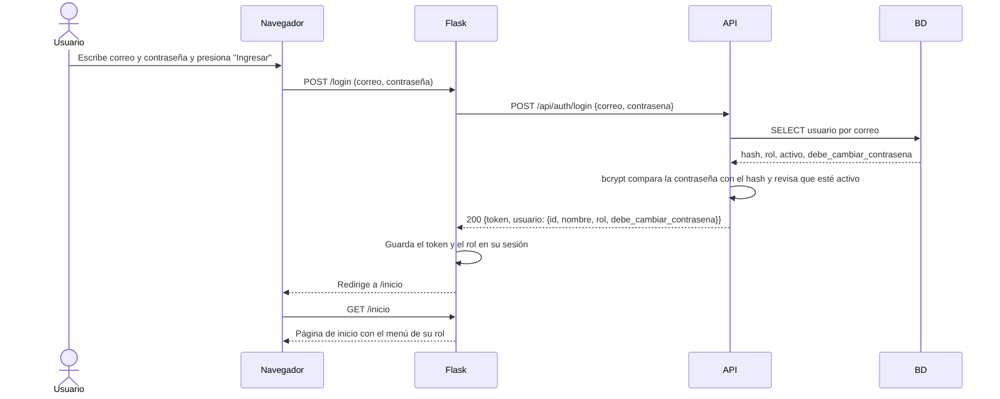
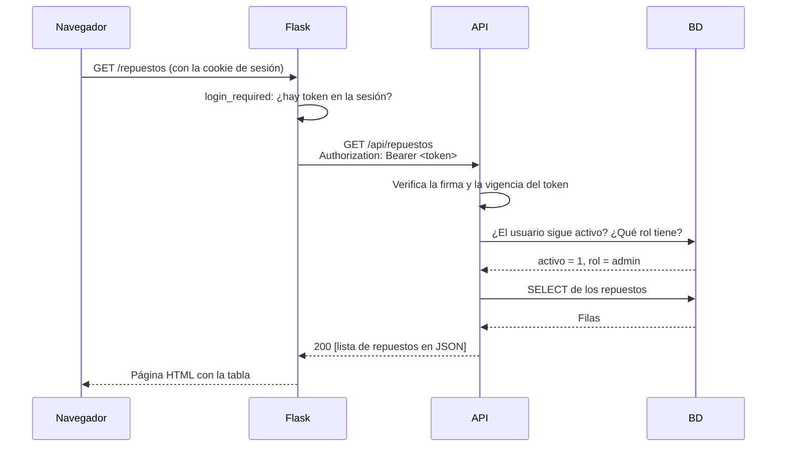
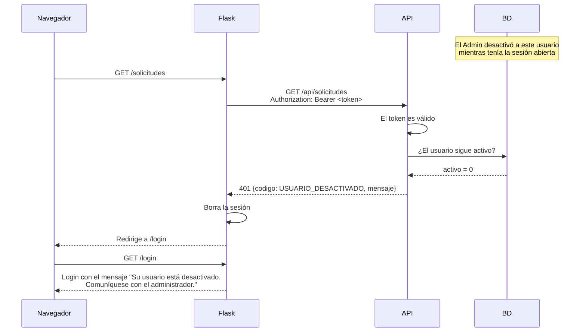
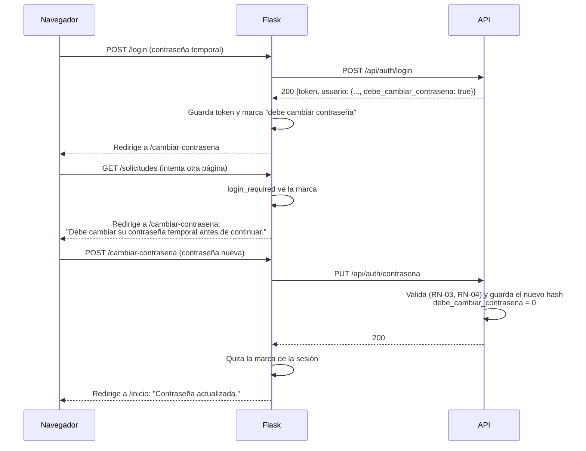

# Arquitectura y API de FacturApp

El navegador solo habla con Flask (frontend). Flask llama a la API de FastAPI (backend) desde el servidor, y solo la API habla con la base de datos `facturapp` (MySQL 8 o MariaDB).

```
Navegador -> Flask (puerto 5050) -> API FastAPI (puerto 8000, JSON) -> MySQL o MariaDB (puerto 3306)
```

Las referencias RN, RNF y HU corresponden a `02-requisitos.md`.

## 1. Capas del backend

```
backend/
├── app/
│   ├── main.py              Crea la aplicación FastAPI, registra los routers y los manejadores de errores
│   ├── core/                Configuración y seguridad que usa toda la API
│   │   ├── config.py        Lee el .env: datos de la base, clave del JWT y tiempo de sesión
│   │   ├── seguridad.py     Cifra y verifica contraseñas (bcrypt); crea y verifica tokens (JWT)
│   │   ├── dependencias.py  Obtiene el usuario actual desde el token y exige un rol
│   │   └── errores.py       Errores del negocio y el código HTTP de cada uno (404, 409...)
│   ├── db/                  Conexión a la base de datos
│   │   └── conexion.py      Abre la conexión con PyMySQL y maneja la transacción (COMMIT o ROLLBACK)
│   ├── schemas/             Forma de los datos que entran y salen, validada con Pydantic
│   ├── routers/             Rutas de la API: reciben la petición y devuelven la respuesta
│   ├── services/            Reglas del negocio: permisos finos, stock, estados e historial
│   └── repositories/        Consultas SQL de cada tabla; única capa que toca la base de datos
├── tests/                   Pruebas con pytest
├── .env                     Credenciales reales (no se sube a git)
├── .env.example             Las mismas variables, sin valores reales
└── requirements.txt         Librerías del backend con su versión exacta
```

| Capa | Responsabilidad |
|---|---|
| `core/` | Guarda lo que usa toda la API: la configuración, la seguridad (contraseñas y tokens), la verificación del usuario y su rol, y los errores. |
| `db/` | Abre la conexión con la base de datos y asegura que cada operación se guarde completa o no se guarde (RN-17). |
| `schemas/` | Define y valida la forma de los datos que llegan y salen, antes de tocar la base de datos. |
| `routers/` | Recibe cada petición HTTP, llama al service que corresponde y devuelve el código y el JSON de respuesta. |
| `services/` | Aplica las reglas del negocio (RN) y coordina los repositories dentro de una transacción. |
| `repositories/` | Contiene el SQL (PyMySQL, sin ORM); es la única capa que habla con las tablas. |

**Orden de las llamadas:** `routers` → `services` → `repositories` → base de datos. Cada capa solo habla con la siguiente: un router nunca escribe SQL y un repository nunca decide reglas del negocio (RNF-23).

## 2. Recorrido de una petición: "crear entrega"

**Historia:** HU-21, registrar una entrega total o parcial.
**Ejemplo:** el Admin entrega los 2 motores MOT-001 que faltan en la solicitud SOL-000002.
**Endpoint:** `POST /api/solicitudes/2/entregas`
**Datos que envía Flask (JSON):**

```json
{ "repuestos": [ { "repuesto_id": 5, "cantidad": 2 } ] }
```

### En el frontend (Flask)

1. **`frontend/src/templates/solicitudes/detalle.html`:** el Admin presiona "Registrar entrega", escribe las cantidades y confirma (RNF-09). El botón solo se muestra al Admin, pero eso es una comodidad, no la protección real.
2. **`frontend/src/controllers/solicitudes_controller.py`:** Flask recibe el formulario, toma el token de la sesión y arma el JSON.
3. **`frontend/src/services/api_cliente.py`:** Flask envía la petición a la API desde el servidor, con el encabezado `Authorization: Bearer <token>`.

### En la API (FastAPI)

4. **`app/main.py` → `app/routers/entregas.py`:** FastAPI encuentra la ruta `POST /api/solicitudes/{solicitud_id}/entregas`.
5. **`app/core/dependencias.py` y `app/core/seguridad.py` — permiso 1, quién es:** se verifica la firma y la vigencia del token y se obtiene el usuario. Si el token no es válido o venció, responde **401** (RNF-02).
6. **`app/core/dependencias.py` (`requiere_rol("admin")`) — permiso 2, qué puede hacer:** solo el Admin registra entregas. Si es la Oficina radicadora, responde **403** (RN-02).
7. **`app/schemas/entregas.py` (`EntregaCrear`):** Pydantic valida que haya al menos un repuesto, que las cantidades sean mayores que cero, con máximo 2 decimales, y que no se repita un repuesto. Si algo falla, responde **422** (RN-11, RN-15).
8. **`app/routers/entregas.py`:** el router llama a `registrar_entrega(...)` de `app/services/entregas_service.py`, con los datos y el usuario.
9. **`app/db/conexion.py`:** el service abre una transacción. Desde aquí, o se guarda todo o no se guarda nada (RN-17).
10. **`app/repositories/solicitudes_repo.py`:** se lee la solicitud con `SELECT ... FOR UPDATE`, que la bloquea mientras dura la operación. El service revisa que exista (si no, **404**), que esté abierta (RN-22) y que su contratista esté activo (RN-31); si no, responde **409**.
11. **`app/repositories/detalle_solicitud_repo.py`:** se leen las filas del detalle, también con bloqueo. El service revisa que cada repuesto pertenezca a la solicitud, que no se entregue más de lo pendiente (RN-16) ni más de lo apartado (RN-33, RN-34) y que los decimales correspondan a la unidad de medida (RN-12). Si algo falla, responde **409**.
12. **`app/repositories/repuestos_repo.py` — revisión del stock:** se lee el repuesto con `FOR UPDATE` y el service comprueba que `stock_almacen` alcance (RN-10). Si no alcanza, responde **409** con el mensaje "No hay stock suficiente de MOT-001. Disponible: …". El bloqueo evita que dos Admin entreguen el mismo stock al mismo tiempo.
13. **`app/repositories/consecutivos_repo.py`:** se bloquea el contador `REM`, se le suma 1 y se arma el número **REM-000003** (RN-18).
14. **`app/repositories/entregas_repo.py`:** se guarda la entrega en `entregas` (con el contratista de la solicitud, el usuario y la fecha automática) y sus repuestos en `detalle_entrega`.
15. **`app/repositories/detalle_solicitud_repo.py`:** se actualiza el detalle: entregada +2 y apartada −2.
16. **`app/repositories/repuestos_repo.py`:** se actualiza el repuesto: stock en almacén −2 y apartado −2.
17. **`app/repositories/movimientos_repo.py`:** se guarda el movimiento de inventario: tipo "entrega", cantidad −2 y el stock que quedó.
18. **`app/repositories/historial_repo.py`:** se guarda en la línea de tiempo de la solicitud: "Remisión REM-000003".
19. **`app/db/conexion.py`:** se hace **COMMIT**. En este momento actúan los CHECK de MySQL como red de seguridad: si algo se escapó del service (por ejemplo, un stock negativo), la base de datos lo rechaza y se hace **ROLLBACK**.
20. **`app/services/entregas_service.py`:** calcula el nuevo estado de la entrega (en el ejemplo, "Completa", RN-21) y devuelve el resultado.
21. **`app/routers/entregas.py` y `app/schemas/entregas.py` (`EntregaRespuesta`):** la API responde **201 Created** con un JSON que trae el número de remisión, el estado de la entrega y los repuestos entregados.

Si cualquier paso entre el 9 y el 19 falla, el service lanza un error definido en `app/core/errores.py`, se hace ROLLBACK y `app/main.py` lo convierte en el código HTTP y el mensaje que corresponden. **No se guarda nada.**

### De vuelta en Flask

22. **`frontend/src/controllers/solicitudes_controller.py`:** si recibe **201**, muestra "Entrega registrada. Remisión REM-000003 generada." y vuelve al detalle de la solicitud.
23. **El mismo archivo:** si recibe **409 o 422**, muestra el mensaje de error sin borrar lo que el usuario escribió (RNF-08); si recibe **401**, lo lleva a la pantalla de inicio de sesión.

### Dónde se revisan los permisos y el stock

| Qué | Dónde | Para qué |
|---|---|---|
| Permisos | Flask, paso 1: oculta el botón a quien no tiene el rol | Comodidad; no es seguridad |
| | **`app/core/dependencias.py`**, pasos 5 y 6: token y rol | Protección real, aunque alguien escriba la dirección a mano |
| Stock | **`app/services/entregas_service.py`**, pasos 11 y 12, con los datos bloqueados | Revisión principal, con un mensaje claro para el usuario |
| | **CHECK de MySQL**, paso 19 | Última barrera, por si el código tiene un error |

## 3. Lista de endpoints

### 3.1 Convenciones

- **Dirección base:** `http://localhost:8000`, y todas las rutas empiezan por `/api` (por ejemplo, `/api/repuestos`). Solo Flask la usa; el navegador nunca llama a la API.
- **Formato:** todo entra y sale en JSON, con nombres en español y sin tildes (`fecha_entrega`, `stock_almacen`).
- **Autenticación:** todas las rutas, excepto `POST /api/auth/login`, exigen el encabezado `Authorization: Bearer <token>`.
- **Errores:** todos con el mismo formato JSON, con un mensaje para el usuario y un código corto para el programa (sección 7).
- **Nada se borra:** no hay rutas DELETE. Desactivar es un `PATCH .../estado`, y retractar, anular, cerrar o reabrir son `POST` que registran el evento (RN-05, RN-26).
- **Roles:** "Todos" = Admin y Oficina radicadora.

### 3.2 Códigos de respuesta

| Código | Cuándo |
|---|---|
| 200 OK | Consulta o cambio correcto |
| 201 Created | Se creó un registro (solicitud, entrega, entrada...) |
| 401 Unauthorized | Sin token, token alterado, sesión vencida o usuario desactivado (RNF-02, RNF-03, RN-01) |
| 403 Forbidden | El rol no tiene permiso (RN-02) |
| 404 Not Found | El registro no existe |
| 409 Conflict | Choca con una regla de negocio: repetido, sin stock, solicitud cerrada, etc. |
| 422 Unprocessable Entity | Datos con forma inválida: faltan campos, cantidad ≤ 0, decimales de más (validación de `schemas/`) |

Todas las rutas protegidas pueden responder **401**, y las que no son de "Todos" pueden responder **403**; por eso las tablas siguientes solo nombran los códigos propios de cada ruta.

### 3.3 Autenticación

| Método | Ruta | Rol | Para qué | HU | Fase | Respuestas propias |
|---|---|---|---|---|:---:|---|
| POST | `/api/auth/login` | Público | Iniciar sesión con correo y contraseña; devuelve el token y el rol | HU-01 | 1 | 200, 401 (datos incorrectos o usuario desactivado) |
| GET | `/api/auth/yo` | Todos | Datos del usuario actual y su rol, para armar el menú | HU-03 | 1 | 200 |
| PUT | `/api/auth/contrasena` | Todos | Cambiar la propia contraseña, también la temporal | HU-04, HU-05 | 2 | 200, 409 (clave actual incorrecta o igual a la temporal), 422 |

Cerrar sesión (HU-02) no necesita ruta en la API: Flask borra su sesión. El cambio a la vista de Oficina (HU-06) también lo maneja Flask (PA-26).

### 3.4 Usuarios

| Método | Ruta | Rol | Para qué | HU | Fase | Respuestas propias |
|---|---|---|---|---|:---:|---|
| GET | `/api/usuarios` | Admin | Listar usuarios | HU-09 | 1 | 200 |
| POST | `/api/usuarios` | Admin | Crear usuario | HU-07 | 1 | 201, 409 (correo repetido), 422 |
| GET | `/api/usuarios/{id}` | Admin | Ver un usuario | HU-08 | 1 | 200, 404 |
| PUT | `/api/usuarios/{id}` | Admin | Editar un usuario | HU-08 | 1 | 200, 404, 409, 422 |
| PATCH | `/api/usuarios/{id}/estado` | Admin | Activar o desactivar | HU-10 | 1 | 200, 404, 409 (desactivarse a sí mismo o al último Admin, RN-32) |
| POST | `/api/usuarios/{id}/restaurar-contrasena` | Admin | Asignar una contraseña temporal | HU-11 | 2 | 200, 404 |

### 3.5 Catálogos

| Método | Ruta | Rol | Para qué | HU | Fase | Respuestas propias |
|---|---|---|---|---|:---:|---|
| GET | `/api/categorias` | Todos | Listar categorías | HU-12 | 1 | 200 |
| POST | `/api/categorias` | Admin | Crear categoría | HU-12 | 1 | 201, 409 (nombre repetido), 422 |
| PUT | `/api/categorias/{id}` | Admin | Editar categoría | HU-12 | 1 | 200, 404, 409, 422 |
| PATCH | `/api/categorias/{id}/estado` | Admin | Activar o desactivar | HU-12 | 1 | 200, 404, 409 (tiene repuestos activos, RN-06) |
| GET | `/api/repuestos` | Todos | Listar el catálogo **sin datos de stock**, para elegir repuestos en una solicitud | HU-13, HU-17 | 1 | 200 |
| POST | `/api/repuestos` | Admin | Crear repuesto (empieza con stock 0) | HU-13 | 1 | 201, 409 (código o nombre repetido), 422 |
| PUT | `/api/repuestos/{id}` | Admin | Editar repuesto (sin campo de stock, RN-09) | HU-13 | 1 | 200, 404, 409, 422 |
| PATCH | `/api/repuestos/{id}/estado` | Admin | Activar o desactivar | HU-13 | 1 | 200, 404 |
| GET | `/api/contratistas` | Todos | Listar contratistas, para elegir uno en una solicitud | HU-14, HU-17 | 1 | 200 |
| POST | `/api/contratistas` | Admin | Crear contratista | HU-14 | 1 | 201, 409 (cédula o NIT repetido), 422 |
| PUT | `/api/contratistas/{id}` | Admin | Editar contratista | HU-14 | 1 | 200, 404, 409, 422 |
| PATCH | `/api/contratistas/{id}/estado` | Admin | Activar o desactivar | HU-14 | 1 | 200, 404 |
| GET | `/api/equipos` | Todos | Listar equipos | HU-15 | 1 | 200 |
| POST | `/api/equipos` | Todos | Registrar equipo | HU-15 | 1 | 201, 409 (código repetido), 422 |
| GET | `/api/equipos/{id}/solicitudes` | Todos | Historial de solicitudes de un equipo | HU-16 | 2 | 200, 404 |

### 3.6 Inventario

| Método | Ruta | Rol | Para qué | HU | Fase | Respuestas propias |
|---|---|---|---|---|:---:|---|
| GET | `/api/inventario` | Admin | Stock en almacén, apartado, disponible y en espera de cada repuesto | HU-20 | 1 | 200 |
| POST | `/api/inventario/entradas` | Admin | Registrar una entrada al almacén; aparta para las solicitudes en espera (RN-33) | HU-19 | 1 | 201, 404, 409 (repuesto inactivo), 422 |
| POST | `/api/inventario/entradas/{id}/retraccion` | Admin | Retractar una entrada, con motivo | HU-32 | 1 | 200, 404, 409 (ese stock ya se entregó o está apartado, RN-27), 422 |
| GET | `/api/inventario/{repuesto_id}/movimientos` | Admin | Historial de movimientos de un repuesto | HU-27 | 2 | 200, 404 |

### 3.7 Solicitudes

| Método | Ruta | Rol | Para qué | HU | Fase | Respuestas propias |
|---|---|---|---|---|:---:|---|
| GET | `/api/solicitudes` | Todos | Listar solicitudes; en la fase 2 acepta filtros (`?estado=`, `?equipo_id=`, `?contratista_id=`, `?desde=`, `?hasta=`, `?buscar=`) | HU-18, HU-25 | 1 | 200 |
| POST | `/api/solicitudes` | Todos | Crear solicitud; aparta lo disponible y deja el resto en espera | HU-17 | 1 | 201, 409 (equipo, contratista o repuesto inactivo), 422 |
| GET | `/api/solicitudes/{id}` | Todos | Detalle: repuestos (solicitado, entregado, pendiente), remisiones y línea de tiempo | HU-18, HU-22 | 1 | 200, 404 |
| PUT | `/api/solicitudes/{id}` | Admin | Editar una solicitud sin entregas vigentes | HU-34 | 1 | 200, 404, 409 (tiene entregas, RN-29), 422 |
| POST | `/api/solicitudes/{id}/anulacion` | Admin | Anular, con motivo | HU-34 | 1 | 200, 404, 409 (tiene entregas o está cerrada), 422 |
| POST | `/api/solicitudes/{id}/cierre` | Todos | Marcar como reparado o devuelto (devuelto exige motivo; con pendientes exige confirmación) | HU-23 | 1 | 200, 404, 409 (ya cerrada, RN-22), 422 |
| POST | `/api/solicitudes/{id}/reapertura` | Admin | Reabrir una solicitud reparada o devuelta, con motivo | HU-35 | 1 | 200, 404, 409 (anulada o abierta, RN-30), 422 |
| PATCH | `/api/solicitudes/{id}/contratista` | Admin | Reasignar el contratista | HU-36 | 1 | 200, 404, 409 (contratista inactivo o solicitud cerrada) |
| POST | `/api/solicitudes/{id}/reemplazos` | Admin | Reemplazar un repuesto desactivado sin stock | HU-37 | 1 | 201, 404, 409 (el repuesto tiene stock o está activo, RN-34), 422 |

### 3.8 Entregas, remisiones y devoluciones

| Método | Ruta | Rol | Para qué | HU | Fase | Respuestas propias |
|---|---|---|---|---|:---:|---|
| POST | `/api/solicitudes/{id}/entregas` | Admin | Registrar una entrega total o parcial y generar su remisión (ver sección 2) | HU-21 | 1 | 201, 404, 409 (sin stock, más de lo pendiente, solicitud cerrada, contratista inactivo), 422 |
| POST | `/api/entregas/{id}/retraccion` | Admin | Retractar una entrega, con motivo | HU-31 | 1 | 200, 404, 409 (ya retractada o solicitud cerrada), 422 |
| GET | `/api/entregas/{id}/remision` | Todos | Datos de la remisión para verla e imprimirla | HU-24 | 1 | 200, 404 |
| GET | `/api/entregas/{id}/remision.pdf` | Todos | Descargar la remisión en PDF | HU-29 | 2 | 200, 404 |
| POST | `/api/solicitudes/{id}/devoluciones` | Admin | Registrar la devolución de repuestos no usados (también en solicitudes cerradas) | HU-33 | 1 | 201, 404, 409 (más de lo entregado, RN-28), 422 |

### 3.9 Inicio y reportes

| Método | Ruta | Rol | Para qué | HU | Fase | Respuestas propias |
|---|---|---|---|---|:---:|---|
| GET | `/api/inicio/resumen` | Todos | Solicitudes por estado y entregas pendientes; al Admin también le muestra stock bajo | HU-26 | 2 | 200 |
| GET | `/api/reportes/entregas-por-contratista` | Admin | Reporte por rango de fechas (`?desde=&hasta=`); con `?formato=csv` descarga el archivo | HU-30 | 2 | 200 |
| GET | `/api/reportes/repuestos-mas-usados` | Admin | Reporte por rango de fechas; con `?formato=csv` descarga el archivo | HU-30 | 2 | 200 |

### 3.10 Resumen

- **Total:** 45 rutas: 37 de la fase 1 y 8 de la fase 2.
- La documentación interactiva de todas las rutas la genera FastAPI en `http://localhost:8000/docs`.

## 4. Capas del frontend

### 4.1 Carpetas

La aplicación Flask sigue el patrón del prototipo: `create_app` y un Blueprint por módulo.

```
frontend/
├── src/
│   ├── __init__.py            create_app: crea la aplicación, lee el .env y registra los Blueprints (solo aquí)
│   ├── app.py                 Punto de arranque del frontend
│   ├── auth.py                Decoradores login_required y admin_required, que protegen las rutas de Flask
│   ├── controllers/           Un Blueprint por módulo: recibe la petición del navegador y responde con una página
│   │   ├── auth_controller.py        Iniciar y cerrar sesión
│   │   ├── inicio_controller.py      Página de inicio
│   │   ├── usuarios_controller.py
│   │   ├── categorias_controller.py
│   │   ├── repuestos_controller.py
│   │   ├── contratistas_controller.py
│   │   ├── equipos_controller.py
│   │   ├── inventario_controller.py
│   │   ├── solicitudes_controller.py Solicitudes, entregas, devoluciones y correcciones
│   │   └── remisiones_controller.py  Ver e imprimir remisiones
│   ├── services/
│   │   └── api_cliente.py     El único archivo que habla con la API: agrega el token y traduce las respuestas
│   ├── templates/             Plantillas Jinja2: layout.html y una carpeta por módulo
│   │   ├── layout.html        Estructura común: menú según el rol y mensajes
│   │   └── repuestos/         lista.html y formulario.html (igual en cada módulo)
│   └── static/                Archivos que el navegador descarga tal cual
│       ├── css/               CSS propio (sin Bootstrap)
│       ├── js/                JavaScript en módulos (ES modules)
│       └── img/               Imágenes y logo
├── .env                       Dirección de la API y clave de la sesión (no se sube a git)
├── .env.example               Las mismas variables, sin valores reales
└── requirements.txt           Librerías del frontend con su versión exacta
```

| Capa | Responsabilidad |
|---|---|
| `__init__.py` y `app.py` | Crean y arrancan la aplicación Flask y registran todos los Blueprints en un solo lugar. |
| `auth.py` | Revisa antes de cada página si hay sesión (`login_required`) y si el rol es Admin (`admin_required`); si no, redirige con un mensaje. |
| `controllers/` | Cada Blueprint recibe las peticiones de su módulo, pide los datos a `api_cliente.py` y devuelve la página que corresponde. |
| `services/api_cliente.py` | Es el único que habla con la API: arma la dirección, agrega el token de la sesión y convierte cada código de respuesta en datos o en un error claro. |
| `templates/` | Arman el HTML que ve el usuario a partir de los datos que les pasa el controller. |
| `static/` | Guarda el CSS, el JavaScript y las imágenes que el navegador descarga sin procesar. |

**Regla de capas:** ninguna plantilla ni controller llama a la API directamente: todo pasa por `api_cliente.py`. Así, si cambia la dirección de la API o la forma de enviar el token, solo se cambia un archivo.

**`auth.py` no reemplaza a la API:** ocultar una página en Flask es una comodidad para el usuario; la protección real la hace la API (`core/dependencias.py`, sección 2), que revisa el token y el rol en cada petición.

### 4.2 Recorrido: el Admin abre la página de repuestos

1. **Navegador:** el Admin hace clic en "Repuestos" en el menú, y el navegador pide `GET http://localhost:5050/repuestos`.
2. **`frontend/src/__init__.py`:** Flask encuentra la ruta `/repuestos`, que pertenece al Blueprint registrado en `controllers/repuestos_controller.py`.
3. **`frontend/src/auth.py` (`@login_required`):** revisa que la sesión tenga un token. Si no lo tiene, redirige a la pantalla de inicio de sesión.
4. **`frontend/src/auth.py` (`@admin_required`):** revisa que el rol guardado en la sesión sea Admin, porque gestionar repuestos es del Admin (HU-13). Si es la Oficina radicadora, la redirige a su inicio con el mensaje "No tiene permiso para ver esta página." (HU-03).
5. **`frontend/src/controllers/repuestos_controller.py`:** la función de la ruta pide la lista de repuestos a `api_cliente.py`.
6. **`frontend/src/services/api_cliente.py`:** lee la dirección de la API del `.env`, toma el token de la sesión y envía `GET http://localhost:8000/api/repuestos` con el encabezado `Authorization: Bearer <token>`.
7. **En la API:** `core/dependencias.py` verifica el token, `routers/repuestos.py` llama al service, y `repositories/repuestos_repo.py` hace el `SELECT`. La API responde **200** con la lista en JSON (sin datos de stock; el stock está en la página de Inventario).
8. **`frontend/src/services/api_cliente.py`:** según el código que recibe:
   - **200:** devuelve la lista al controller.
   - **401:** la sesión venció o el usuario fue desactivado; avisa al controller, que borra la sesión y lleva al login con el mensaje que envía la API, por ejemplo "Su sesión expiró. Inicie sesión de nuevo." (HU-02, sección 5.3).
   - **403:** avisa al controller, que lleva al inicio con "No tiene permiso para ver esta página.".
   - **La API no responde:** avisa al controller, que muestra un mensaje de error de conexión.
9. **`frontend/src/controllers/repuestos_controller.py`:** llama a `render_template("repuestos/lista.html", repuestos=lista)`.
10. **`frontend/src/templates/repuestos/lista.html`:** extiende `layout.html`, que arma el menú según el rol. Recorre la lista y crea una fila por repuesto con código, nombre, categoría, unidad de medida y estado; si la lista está vacía, muestra un mensaje en lugar de la tabla.
11. **Flask:** devuelve la página HTML al navegador con código **200**.
12. **Navegador:** descarga el CSS y el JavaScript de `static/` y muestra la tabla de repuestos.

## 5. Flujo de autenticación

Participantes de los diagramas: el **Navegador** del usuario, **Flask** (frontend, puerto 5050), la **API** (FastAPI, puerto 8000) y la **BD** (base de datos `facturapp`).

### 5.1 Login correcto (HU-01, fase 1)



Flask recibe la contraseña una sola vez y se la pasa a la API, que la compara con el hash guardado usando bcrypt. Si es correcta y el usuario está activo, la API firma un token JWT y lo devuelve. Flask guarda el token en su sesión y desde ese momento lo usa en cada petición. Si el correo o la contraseña no coinciden, la API responde 401 y Flask vuelve a mostrar el login con "Correo o contraseña incorrectos.".

### 5.2 Petición normal (fase 1)



En cada petición, Flask agrega el token en la cabecera `Authorization: Bearer`. La API no confía solo en el token: también revisa en la base de datos que el usuario siga activo y cuál es su rol, para que un cambio hecho por el Admin se aplique de inmediato.

### 5.3 Usuario desactivado (RN-01, fase 1)



Aunque el token todavía no haya vencido, la API comprueba en cada petición que el usuario esté activo. Si fue desactivado, responde 401 con el código `USUARIO_DESACTIVADO`. Flask cierra la sesión y muestra en el login el mensaje de HU-01. Si un usuario desactivado intenta iniciar sesión, la API responde lo mismo desde `POST /api/auth/login`.

### 5.4 Contraseña temporal (RN-04, HU-05, fase 2)



Si la API indica `debe_cambiar_contrasena: true`, Flask lleva al usuario a "Cambiar contraseña" y `login_required` no le deja abrir otras páginas hasta que la cambie. La protección real también está en la API: mientras el usuario tenga la contraseña temporal, cualquier otra ruta responde 403 con el código `CAMBIO_CONTRASENA_REQUERIDO`. Este flujo es de la fase 2, como HU-05 y HU-11.

## 6. Contrato de la API

Endpoints de la **fase 1**. Todas las rutas empiezan por `/api` y exigen `Authorization: Bearer <token>`, salvo `POST /api/auth/login`. Todas pueden responder **401** (sin token, sesión vencida o usuario desactivado), y las que no son de "Todos" pueden responder **403**; las tablas solo nombran los demás errores. Los errores usan el formato de la sección 7, y el texto entre paréntesis es su `codigo`.

Además de los seis módulos pedidos, se incluyen **equipos, inventario y solicitudes**, porque la fase 1 no funciona sin ellos.

### 6.1 auth

| Método | Ruta | Rol | Recibe | Devuelve | Errores | HU |
|---|---|---|---|---|---|---|
| POST | `/api/auth/login` | Público | `correo`, `contrasena` | 200: `token`, `usuario` (`id`, `nombre`, `rol`, `debe_cambiar_contrasena`) | 401 (`CREDENCIALES_INVALIDAS`, `USUARIO_DESACTIVADO`), 422 | HU-01 |
| GET | `/api/auth/yo` | Todos | — | 200: `id`, `nombre`, `correo`, `rol`, `debe_cambiar_contrasena` | — | HU-03 |

### 6.2 usuarios

| Método | Ruta | Rol | Recibe | Devuelve | Errores | HU |
|---|---|---|---|---|---|---|
| GET | `/api/usuarios` | Admin | — | 200: lista de `id`, `nombre`, `correo`, `rol`, `activo` | — | HU-09 |
| POST | `/api/usuarios` | Admin | `nombre`, `correo`, `rol`, `contrasena` | 201: el usuario creado (sin contraseña) | 409 (`CORREO_REPETIDO`), 422 | HU-07 |
| GET | `/api/usuarios/{id}` | Admin | — | 200: el usuario | 404 (`NO_ENCONTRADO`) | HU-08 |
| PUT | `/api/usuarios/{id}` | Admin | `nombre`, `correo`, `rol` | 200: el usuario actualizado | 404, 409 (`CORREO_REPETIDO`), 422 | HU-08 |
| PATCH | `/api/usuarios/{id}/estado` | Admin | `activo` (true o false) | 200: el usuario con su nuevo estado | 404, 409 (`NO_PUEDE_DESACTIVARSE`, `ULTIMO_ADMIN`) | HU-10 |

### 6.3 categorias

| Método | Ruta | Rol | Recibe | Devuelve | Errores | HU |
|---|---|---|---|---|---|---|
| GET | `/api/categorias` | Todos | `?activo=` (opcional) | 200: lista de `id`, `nombre`, `activo` | — | HU-12 |
| POST | `/api/categorias` | Admin | `nombre` | 201: la categoría creada | 409 (`NOMBRE_REPETIDO`), 422 | HU-12 |
| PUT | `/api/categorias/{id}` | Admin | `nombre` | 200: la categoría actualizada | 404, 409 (`NOMBRE_REPETIDO`), 422 | HU-12 |
| PATCH | `/api/categorias/{id}/estado` | Admin | `activo` | 200: la categoría con su nuevo estado | 404, 409 (`CATEGORIA_CON_REPUESTOS`) | HU-12 |

### 6.4 repuestos

| Método | Ruta | Rol | Recibe | Devuelve | Errores | HU |
|---|---|---|---|---|---|---|
| GET | `/api/repuestos` | Todos | `?activo=` (opcional) | 200: lista de `id`, `codigo`, `nombre`, `categoria`, `unidad_medida`, `activo` (sin stock) | — | HU-13, HU-17 |
| POST | `/api/repuestos` | Admin | `codigo`, `nombre`, `categoria_id`, `unidad_medida` | 201: el repuesto creado, con stock 0 | 409 (`CODIGO_REPETIDO`, `NOMBRE_REPETIDO`), 422 (`CARACTERES_NO_PERMITIDOS`) | HU-13 |
| PUT | `/api/repuestos/{id}` | Admin | `codigo`, `nombre`, `categoria_id`, `unidad_medida` | 200: el repuesto actualizado | 404, 409, 422 | HU-13 |
| PATCH | `/api/repuestos/{id}/estado` | Admin | `activo` | 200: el repuesto con su nuevo estado | 404 | HU-13 |

### 6.5 contratistas

| Método | Ruta | Rol | Recibe | Devuelve | Errores | HU |
|---|---|---|---|---|---|---|
| GET | `/api/contratistas` | Todos | `?activo=` (opcional) | 200: lista de `id`, `documento`, `nombre`, `telefono`, `activo` | — | HU-14, HU-17 |
| POST | `/api/contratistas` | Admin | `documento`, `nombre`, `telefono` | 201: el contratista creado | 409 (`DOCUMENTO_REPETIDO`), 422 (`CARACTERES_NO_PERMITIDOS`) | HU-14 |
| PUT | `/api/contratistas/{id}` | Admin | `documento`, `nombre`, `telefono` | 200: el contratista actualizado | 404, 409 (`DOCUMENTO_REPETIDO`), 422 | HU-14 |
| PATCH | `/api/contratistas/{id}/estado` | Admin | `activo` | 200: el contratista con su nuevo estado | 404 | HU-14 |

### 6.6 equipos

| Método | Ruta | Rol | Recibe | Devuelve | Errores | HU |
|---|---|---|---|---|---|---|
| GET | `/api/equipos` | Todos | `?activo=` (opcional) | 200: lista de `id`, `codigo`, `descripcion`, `activo` | — | HU-15, HU-17 |
| POST | `/api/equipos` | Todos | `codigo`, `descripcion` | 201: el equipo creado | 409 (`CODIGO_REPETIDO`), 422 (`CARACTERES_NO_PERMITIDOS`) | HU-15 |

### 6.7 inventario

| Método | Ruta | Rol | Recibe | Devuelve | Errores | HU |
|---|---|---|---|---|---|---|
| GET | `/api/inventario` | Admin | — | 200: por repuesto, `stock_almacen`, `stock_apartado`, `disponible` y `en_espera` | — | HU-20 |
| POST | `/api/inventario/entradas` | Admin | `repuesto_id`, `cantidad`, `observacion` | 201: la entrada, el stock actual y lo apartado para solicitudes en espera | 404, 409 (`REPUESTO_INACTIVO`), 422 (`CANTIDAD_INVALIDA`) | HU-19 |
| POST | `/api/inventario/entradas/{id}/retraccion` | Admin | `motivo` | 200: la entrada retractada y el stock actual | 404, 409 (`STOCK_YA_USADO`, `YA_RETRACTADA`), 422 (`MOTIVO_OBLIGATORIO`) | HU-32 |

### 6.8 solicitudes

| Método | Ruta | Rol | Recibe | Devuelve | Errores | HU |
|---|---|---|---|---|---|---|
| GET | `/api/solicitudes` | Todos | — | 200: lista de `id`, `numero`, `creado_en`, `equipo`, `contratista`, `estado`, `estado_entrega` | — | HU-18 |
| POST | `/api/solicitudes` | Todos | `equipo_id`, `contratista_id`, `fecha_entrega`, `repuestos` [`repuesto_id`, `cantidad`] | 201: la solicitud con su `numero` y, por repuesto, lo apartado y lo que quedó en espera | 409 (`EQUIPO_INACTIVO`, `CONTRATISTA_INACTIVO`, `REPUESTO_INACTIVO`), 422 (`FECHA_ANTERIOR`, `SIN_REPUESTOS`, `REPUESTO_REPETIDO`, `CANTIDAD_INVALIDA`) | HU-17 |
| GET | `/api/solicitudes/{id}` | Todos | — | 200: datos, repuestos (solicitado, entregado, apartado, en espera, pendiente), remisiones y línea de tiempo | 404 | HU-18, HU-22 |
| PUT | `/api/solicitudes/{id}` | Admin | `equipo_id`, `contratista_id`, `fecha_entrega`, `repuestos` | 200: la solicitud actualizada | 404, 409 (`TIENE_ENTREGAS`, `SOLICITUD_CERRADA`), 422 | HU-34 |
| POST | `/api/solicitudes/{id}/anulacion` | Admin | `motivo` | 200: la solicitud anulada | 404, 409 (`TIENE_ENTREGAS`, `SOLICITUD_CERRADA`), 422 (`MOTIVO_OBLIGATORIO`) | HU-34 |
| POST | `/api/solicitudes/{id}/cierre` | Todos | `estado` (`reparado` o `devuelto`), `motivo` (obligatorio si es devuelto), `confirmar_pendientes` | 200: la solicitud cerrada | 404, 409 (`SOLICITUD_CERRADA`, `TIENE_PENDIENTES` si falta confirmar), 422 (`MOTIVO_OBLIGATORIO`) | HU-23 |
| POST | `/api/solicitudes/{id}/reapertura` | Admin | `motivo` | 200: la solicitud abierta | 404, 409 (`SOLICITUD_ANULADA`, `SOLICITUD_ABIERTA`), 422 (`MOTIVO_OBLIGATORIO`) | HU-35 |
| PATCH | `/api/solicitudes/{id}/contratista` | Admin | `contratista_id` | 200: la solicitud con el nuevo contratista | 404, 409 (`CONTRATISTA_INACTIVO`, `SOLICITUD_CERRADA`) | HU-36 |
| POST | `/api/solicitudes/{id}/reemplazos` | Admin | `detalle_id`, `repuesto_nuevo_id` | 201: la fila nueva y la fila reemplazada | 404, 409 (`REEMPLAZO_NO_PERMITIDO`, `REPUESTO_INACTIVO`) | HU-37 |

### 6.9 entregas

| Método | Ruta | Rol | Recibe | Devuelve | Errores | HU |
|---|---|---|---|---|---|---|
| POST | `/api/solicitudes/{id}/entregas` | Admin | `repuestos` [`repuesto_id`, `cantidad`] | 201: `numero_remision`, `estado_entrega` y los repuestos entregados | 404, 409 (`STOCK_INSUFICIENTE`, `MAS_DE_LO_PENDIENTE`, `SOLICITUD_CERRADA`, `CONTRATISTA_INACTIVO`), 422 (`SIN_REPUESTOS`, `CANTIDAD_INVALIDA`) | HU-21 |
| POST | `/api/entregas/{id}/retraccion` | Admin | `motivo` | 200: la entrega retractada y el nuevo `estado_entrega` | 404, 409 (`YA_RETRACTADA`, `SOLICITUD_CERRADA`), 422 (`MOTIVO_OBLIGATORIO`) | HU-31 |
| GET | `/api/entregas/{id}/remision` | Todos | — | 200: `numero_remision`, fecha y hora, solicitud, equipo, contratista con documento, usuario que entregó, repuestos y si está retractada | 404 | HU-24 |
| POST | `/api/solicitudes/{id}/devoluciones` | Admin | `repuesto_id`, `cantidad`, `observacion` | 201: la devolución y el stock actual | 404, 409 (`MAS_DE_LO_ENTREGADO`), 422 (`CANTIDAD_INVALIDA`) | HU-33 |

### 6.10 Endpoints de la fase 2

- `PUT /api/auth/contrasena`: cambiar la propia contraseña o la temporal (HU-04, HU-05).
- `POST /api/usuarios/{id}/restaurar-contrasena`: asignar una contraseña temporal (HU-11).
- `GET /api/equipos/{id}/solicitudes`: historial de un equipo (HU-16).
- `GET /api/inventario/{repuesto_id}/movimientos`: movimientos de un repuesto (HU-27).
- Filtros de `GET /api/solicitudes`: `?estado=`, `?equipo_id=`, `?contratista_id=`, `?desde=`, `?hasta=`, `?buscar=` (HU-25).
- `GET /api/entregas/{id}/remision.pdf`: remisión en PDF (HU-29).
- `GET /api/inicio/resumen`: resumen de la página de inicio (HU-26).
- `GET /api/reportes/entregas-por-contratista` y `GET /api/reportes/repuestos-mas-usados`: reportes, con `?formato=csv` para descargar (HU-30).

## 7. Formato de errores

### 7.1 Un único formato

Todos los errores de la API, sin excepción, responden con este JSON:

```json
{
  "error": {
    "codigo": "STOCK_INSUFICIENTE",
    "mensaje": "No hay stock suficiente de MOT-001 Motor ventilador condensador 9 W. Disponible: 1.",
    "campos": null
  }
}
```

- **`codigo`:** texto corto, en mayúsculas y sin espacios, para que Flask decida qué hacer (por ejemplo, si `codigo` es `USUARIO_DESACTIVADO`, cerrar la sesión). Nunca cambia, aunque cambie el mensaje.
- **`mensaje`:** el texto que Flask muestra tal cual al usuario, en español y con los mensajes de las historias de usuario.
- **`campos`:** solo en los errores 422; indica qué campo falló, para marcarlo en el formulario. En los demás errores es `null`.

Ejemplo de un error 422 con `campos`:

```json
{
  "error": {
    "codigo": "DATOS_INVALIDOS",
    "mensaje": "Revise los datos marcados.",
    "campos": {
      "repuestos[0].cantidad": "La cantidad debe ser mayor que cero."
    }
  }
}
```

FastAPI responde por defecto con otro formato (`{"detail": ...}`); en `app/main.py` se registran manejadores de errores que convierten todo al formato anterior.

### 7.2 Códigos HTTP

| Código | Qué significa | Ejemplo real en FacturApp |
|---|---|---|
| 200 OK | La petición salió bien y se devuelven datos | `GET /api/inventario` devuelve el stock de los 6 repuestos. |
| 201 Created | Se creó un registro nuevo | `POST /api/solicitudes/2/entregas` crea la remisión REM-000003. |
| 400 Bad Request | La petición está mal armada y la API no la entiende | Flask envía un JSON roto por un error de programación (`PETICION_INVALIDA`). |
| 401 Unauthorized | No se sabe quién es el usuario, o ya no puede entrar | Token vencido después de 2 horas sin actividad (`SESION_VENCIDA`), contraseña incorrecta (`CREDENCIALES_INVALIDAS`) o usuario desactivado (`USUARIO_DESACTIVADO`). |
| 403 Forbidden | Se sabe quién es, pero su rol no tiene permiso | La Oficina radicadora pide `GET /api/inventario` (`SIN_PERMISO`). |
| 404 Not Found | El registro pedido no existe | `GET /api/solicitudes/999` cuando esa solicitud no existe (`NO_ENCONTRADO`). |
| 409 Conflict | Los datos son válidos, pero chocan con una regla de negocio o con el estado actual | Entregar 3 motores cuando solo hay 1 en almacén (`STOCK_INSUFICIENTE`, RN-10), o crear un repuesto con un código que ya existe (`CODIGO_REPETIDO`). |
| 422 Unprocessable Entity | Los datos tienen forma inválida y no pasan la validación | Una entrada al almacén con cantidad -3 (`CANTIDAD_INVALIDA`, RN-11) o una solicitud sin repuestos (`SIN_REPUESTOS`). |

**Diferencia entre 409 y 422:** el 422 se detecta mirando solo los datos recibidos (una cantidad negativa siempre está mal); el 409 depende de lo que hay en la base de datos (una cantidad de 3 es válida, pero no si solo hay 1 en stock).

## 8. Configuración

### 8.1 Puertos

| Aplicación | Puerto | Dirección |
|---|---|---|
| API (FastAPI con Uvicorn) | 8000 | `http://localhost:8000` |
| Frontend (Flask) | 5050 | `http://localhost:5050` |
| Base de datos (MySQL o MariaDB) | 3306 | — |

**Por qué Flask no usa el 5000:** en Windows ese puerto a veces está reservado por el sistema y Flask no puede arrancar en él, así que usamos el 5050.

### 8.2 `backend/.env.example`

```
# Base de datos (MySQL de AppServ o MariaDB de XAMPP)
DB_HOST=127.0.0.1
DB_PORT=3306
DB_NAME=facturapp
DB_USER=facturapp
DB_PASSWORD=cambia-esto

# Tokens JWT
JWT_CLAVE_SECRETA=cambia-esto-por-una-clave-larga-y-aleatoria
JWT_ALGORITMO=HS256
JWT_MINUTOS_VIGENCIA=480

# API
API_PUERTO=8000
ZONA_HORARIA=America/Bogota
MODO_DEPURACION=false
```

| Variable | Para qué sirve |
|---|---|
| `DB_HOST`, `DB_PORT`, `DB_NAME` | Dónde está la base de datos y cómo se llama. |
| `DB_USER`, `DB_PASSWORD` | Usuario y contraseña de MySQL; nunca `root`. |
| `JWT_CLAVE_SECRETA` | Clave con la que la API firma los tokens; si alguien la conoce, podría fabricar tokens falsos. |
| `JWT_ALGORITMO` | Algoritmo de firma del token. |
| `JWT_MINUTOS_VIGENCIA` | Tiempo máximo de vida de un token (8 horas, una jornada). El cierre por 2 horas sin actividad (RNF-03) lo controla Flask. |
| `API_PUERTO` | Puerto de la API. |
| `ZONA_HORARIA` | Hora de Colombia para fechas y horas (RNF-32). |
| `MODO_DEPURACION` | Muestra detalles técnicos de los errores solo en desarrollo (problema 19 del diagnóstico). |

### 8.3 `frontend/.env.example`

```
# Sesión de Flask
FLASK_CLAVE_SECRETA=cambia-esto-por-una-clave-larga-y-aleatoria
SESION_MINUTOS_INACTIVIDAD=120

# Conexión con la API
API_URL=http://127.0.0.1:8000/api

# Servidor de Flask
FLASK_PUERTO=5050
MODO_DEPURACION=false
```

| Variable | Para qué sirve |
|---|---|
| `FLASK_CLAVE_SECRETA` | Clave con la que Flask firma la cookie de sesión; sin ella, cualquiera podría alterar su sesión. |
| `SESION_MINUTOS_INACTIVIDAD` | Minutos sin actividad antes de cerrar la sesión (RNF-03: 2 horas). |
| `API_URL` | Dirección de la API, con el prefijo `/api`; es lo único que el frontend sabe de ella. |
| `FLASK_PUERTO` | Puerto del frontend (5050). |
| `MODO_DEPURACION` | Modo de depuración de Flask, solo en desarrollo. |

### 8.4 Por qué el `.env` nunca se sube a GitHub

El `.env` contiene secretos reales: la contraseña de la base de datos y las claves que firman los tokens y las sesiones. Si llega a GitHub, cualquiera que vea el repositorio puede entrar a la base de datos o fabricar tokens válidos, y aunque después se borre, queda guardado en el historial de git. Por eso el `.gitignore` lo excluye, y en GitHub solo se sube el `.env.example`, con los mismos nombres de variables y valores de ejemplo como `cambia-esto`. Cada persona copia el `.env.example` como `.env` en su equipo y pone sus propios valores (RNF-06).
