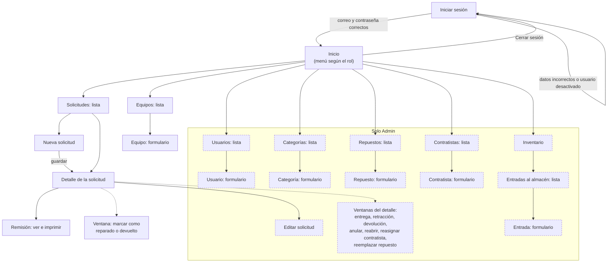

# Diseño UI/UX de FacturApp

Pantallas de la **fase 1**. El rol "usuario" del sistema es la **Oficina radicadora**. Las referencias HU corresponden a `02-requisitos.md`, y las rutas de cada pantalla con sus endpoints están en `04-arquitectura-api.md`, sección 4.3.

## 1. Inventario de pantallas

### 1.1 Admin (20 pantallas y 8 ventanas)

| # | Pantalla | Qué se hace | HU |
|---|---|---|---|
| 1 | Iniciar sesión | Escribir el correo y la contraseña | HU-01 |
| 2 | Inicio | Ver las opciones del rol en el menú; desde el menú se cierra sesión | HU-02, HU-03 |
| 3 | Usuarios: lista | Ver los usuarios y activarlos o desactivarlos | HU-09, HU-10 |
| 4 | Usuario: formulario | Crear un usuario (con contraseña inicial temporal) o editarlo | HU-07, HU-08 |
| 5 | Categorías: lista | Ver las categorías y activarlas o desactivarlas | HU-12 |
| 6 | Categoría: formulario | Crear o editar una categoría | HU-12 |
| 7 | Repuestos: lista | Ver el catálogo (sin stock) y activar o desactivar | HU-13 |
| 8 | Repuesto: formulario | Crear o editar un repuesto: código, nombre, categoría y unidad | HU-13 |
| 9 | Contratistas: lista | Ver los contratistas y activarlos o desactivarlos | HU-14 |
| 10 | Contratista: formulario | Crear o editar un contratista: cédula o NIT, nombre y teléfono | HU-14 |
| 11 | Equipos: lista | Ver las neveras registradas | HU-15 |
| 12 | Equipo: formulario | Registrar una nevera | HU-15 |
| 13 | Inventario | Ver el stock por repuesto: en almacén, apartado, disponible y en espera | HU-20 |
| 14 | Entradas al almacén: lista | Ver las entradas y retractar una con motivo | HU-19, HU-32 |
| 15 | Entrada: formulario | Registrar la mercancía que llega | HU-19 |
| 16 | Solicitudes: lista | Ver todas las solicitudes con su estado | HU-18 |
| 17 | Nueva solicitud | Elegir equipo, contratista, fecha y repuestos con cantidad | HU-17 |
| 18 | Detalle de la solicitud | Ver lo solicitado, entregado y pendiente, las remisiones y la línea de tiempo | HU-18, HU-22 |
| 19 | Editar solicitud | Cambiar una solicitud sin entregas | HU-34 |
| 20 | Remisión | Ver e imprimir la remisión, con espacio para la firma | HU-24 |

**Ventanas dentro del detalle de la solicitud** (formularios cortos o confirmaciones, RNF-09):

| Ventana | Qué se hace | HU |
|---|---|---|
| Registrar entrega | Escribir las cantidades a entregar | HU-21 |
| Retractar entrega | Escribir el motivo, junto a cada remisión | HU-31 |
| Registrar devolución | Elegir el repuesto y la cantidad devuelta | HU-33 |
| Marcar como reparado o devuelto | Confirmar, y escribir el motivo si es devuelto | HU-23 |
| Anular solicitud | Escribir el motivo | HU-34 |
| Reabrir solicitud | Escribir el motivo | HU-35 |
| Reasignar contratista | Elegir un contratista activo | HU-36 |
| Reemplazar repuesto | Elegir el repuesto nuevo para la fila sin stock | HU-37 |

### 1.2 Oficina radicadora (8 pantallas y 1 ventana)

| # | Pantalla | Qué se hace | HU |
|---|---|---|---|
| 1 | Iniciar sesión | Escribir el correo y la contraseña | HU-01 |
| 2 | Inicio | Ver solo las opciones de su rol; desde el menú se cierra sesión | HU-02, HU-03 |
| 3 | Equipos: lista | Ver las neveras registradas | HU-15 |
| 4 | Equipo: formulario | Registrar una nevera | HU-15 |
| 5 | Solicitudes: lista | Ver todas las solicitudes con su estado | HU-18 |
| 6 | Nueva solicitud | Elegir equipo, contratista, fecha y repuestos con cantidad | HU-17 |
| 7 | Detalle de la solicitud | Ver la solicitud, lo entregado y lo pendiente, sus remisiones y la línea de tiempo, sin los botones del Admin | HU-18, HU-22 |
| 8 | Remisión | Ver e imprimir la remisión | HU-24 |

**Su única ventana:** "Marcar como reparado o devuelto" (HU-23).

### 1.3 Pendientes y fase 2

- **Cambiar contraseña (PA-37, sin respuesta):** si el cambio obligatorio de contraseña pasa a la fase 1, se agrega una pantalla para ambos roles, que se abre justo después del login cuando la contraseña es temporal (HU-05).
- **Fuera de este inventario, por ser de la fase 2:** cambiar la propia contraseña, la vista de Oficina para el Admin, el resumen de inicio, los filtros, el historial por equipo, los movimientos de inventario, la remisión en PDF y los reportes.

## 2. Mapa de navegación

**Cómo leer el mapa:**

- **Flechas continuas:** se pasa de una pantalla a otra.
- **Flechas punteadas:** abren una ventana dentro del detalle de la solicitud.
- **Recuadro "Solo Admin":** pantallas que la Oficina radicadora no ve en su menú. Si escribe la dirección a mano, vuelve a Inicio con el mensaje "No tiene permiso para ver esta página." (HU-03).
- **Desde cualquier pantalla:** si la sesión vence o el usuario es desactivado, vuelve a "Iniciar sesión" con el mensaje que corresponde (HU-02, `04-arquitectura-api.md`, sección 5.3).

## 3. Sistema de diseño

Sigue la "Dirección visual" de `CLAUDE.md`. La paleta elegida es la **opción B, verde petróleo**, comparada con la opción A en `prototipo/paletas.html`. Todo el sistema está implementado en **`prototipo/css/ui.css`**, que en el sistema real pasará a `frontend/src/static/css/`.

### 3.1 Paleta

Los colores se definen **una sola vez** como variables CSS en `:root` de `ui.css`; las pantallas solo usan las variables.

| Variable CSS | Color | Uso | Contraste |
|---|---|---|---|
| `--acento` | `#0E6973` | Acción principal, foco del teclado y opción activa del menú. Nada más. | 6,39:1 sobre blanco |
| `--acento-hover` | `#0A535B` | Acción principal al pasar el mouse | 8,75:1 |
| `--acento-suave` | `#E2F0F1` | Fondo de la opción activa del menú | — |
| `--fondo` | `#F3F6F7` | Fondo de la página | — |
| `--superficie` | `#FFFFFF` | Tablas, formularios y remisión | — |
| `--texto` | `#182229` | Texto principal | 14,88:1 sobre el fondo |
| `--texto-2` | `#54626C` | Etiquetas, ayudas, encabezados de tabla y estados neutros | 5,79:1 sobre el fondo |
| `--borde` | `#D5DDE1` | Líneas finas que separan filas y bloques | Decorativo |
| `--borde-campo` | `#7A8892` | Borde de campos y línea bajo el encabezado de tabla | 3,64:1 sobre blanco |
| `--exito` / `--exito-suave` | `#2D7A3A` / `#E8F3EA` | Estados correctos y avisos de éxito | 5,31:1 y 4,66:1 |
| `--advertencia` / `--advertencia-suave` | `#8F5300` / `#FCEFDD` | Estados que piden atención | 6,17:1 y 5,44:1 |
| `--error` / `--error-suave` | `#A8321F` / `#FAEAE6` | Errores y estados de problema | 6,69:1 y 5,72:1 |

Todos los textos cumplen al menos 4,5:1 y los bordes de campo 3:1 (WCAG 2.1 AA, RNF-12).

**Estados y su color.** El color nunca va solo: siempre acompaña al texto del estado (RNF-14).

| Color | Estados |
|---|---|
| Éxito | Completa, Reparado, Activo, Disponible |
| Advertencia | Parcial, En espera, Stock bajo (fase 2) |
| Error | Sin stock, Retractada |
| Neutro (`--texto-2`) | Pendiente, Abierta, Devuelto, Anulada, Inactivo |

### 3.2 Tipografías

| Uso | Fuente | Respaldo |
|---|---|---|
| Textos, títulos, botones y etiquetas | IBM Plex Sans (400, 500 y 600) | Segoe UI, system-ui |
| Códigos, números de solicitud y remisión, documentos y cantidades | IBM Plex Mono (400 y 500) | Consolas |

- **Escala** (variables `--tam-*`): título de página 24 px (600), subtítulo 18 px (600), texto 15 px (400), ayudas 13 px y encabezados de tabla 12 px (600).
- **Números:** siempre con cifras tabulares (`font-variant-numeric: tabular-nums`) y alineados a la derecha en las tablas.
- **Fuentes guardadas en el proyecto** (`frontend/src/static/fuentes/`), no cargadas desde internet, para que el sistema funcione sin conexión.

### 3.3 Espacios, bordes y sombras

- **Espacios:** solo múltiplos de 4 px: 4, 8, 12, 16, 24 y 32.
- **Bordes redondeados:** 4 px en campos, botones y recuadros; 2 px en elementos pequeños.
- **Líneas:** de 1 px con `--borde`; el campo con error lleva 2 px con `--error`.
- **Sombras:** solo en lo que flota (menús desplegables y ventanas de confirmación).
- **Alineación:** todo a la izquierda, sobre una grilla; nada centrado, salvo la pantalla de inicio de sesión.

### 3.4 Componentes

Todas las clases del sistema empiezan por `ui-`. Las variantes se escriben con `--` (por ejemplo, `ui-boton--peligro`) y las partes de un componente con `__` (por ejemplo, `ui-campo__error`).

| Componente | Clases | Para qué |
|---|---|---|
| Botón | `ui-boton` + `--principal`, `--secundario` o `--peligro` | Principal: la acción más importante (una por pantalla). Secundario: acción alternativa con borde. Peligro: acciones irreversibles como retractar o anular. |
| Campo de formulario | `ui-campo`, `__etiqueta`, `__control`, `__ayuda`, `__error`; `ui-campo--error` | Etiqueta siempre visible, ayuda y mensaje de error que aparece solo con `ui-campo--error`. |
| Tabla | `ui-tabla-caja`, `ui-tabla`, `ui-tabla__num`, `ui-tabla__acciones` | Listados con líneas finas; números a la derecha con cifras tabulares; acciones como enlaces al final. |
| Tarjeta | `ui-tarjeta`, `__titulo` | Bloque sobrio con borde fino y sin sombra; se usa poco (datos de la solicitud, formularios). |
| Insignia | `ui-insignia` + `--exito`, `--advertencia`, `--error` o `--neutra` | Estado con un punto de color y su texto. |
| Aviso | `ui-aviso` + `--exito`, `--advertencia` o `--error` | Mensaje después de una acción, con borde izquierdo fino. |
| Diálogo | `ui-dialogo`, `__titulo`, `__acciones` (sobre `<dialog>`) | Ventana de confirmación (RNF-09); lo único con sombra. |
| Estado vacío | `ui-vacio`, `__titulo` | Lo que se muestra cuando una lista no tiene datos, con la acción para empezar. |
| Código o número | `ui-codigo` | Letra IBM Plex Mono con cifras tabulares. |

El foco del teclado es visible en todos los elementos con los que se interactúa: contorno de 3 px del acento, separado 2 px (RNF-13).

**Detalle visual de cada componente:**

| Componente | Cómo se ve |
|---|---|
| **Botón principal** | Fondo `--acento`, texto blanco 15 px (500), bordes de 4 px. Uno solo por pantalla. |
| **Acción secundaria** | Enlace de texto subrayado en `--acento` ("Cancelar", "Editar", "Desactivar"). |
| **Foco del teclado** | Contorno de 3 px en `--acento`, separado 2 px del elemento (RNF-13). |
| **Campo de texto** | Etiqueta arriba (500), conectada con `for` e `id` (RNF-11); borde `--borde-campo`; ayuda en `--texto-2` debajo. Los campos de códigos y cantidades usan IBM Plex Mono. |
| **Campo con error** | Borde de 2 px en `--error` y el mensaje de la historia de usuario debajo, en `--error`. Lo escrito no se borra (RNF-08). |
| **Aviso** | Texto en el color del estado sobre su fondo suave, con un borde izquierdo de 3 px. Primera palabra en negrita ("Entrega registrada."). Sin íconos ni emojis. |
| **Tabla** | Fondo `--superficie`, filas separadas por líneas de 1 px, sin colores alternos. Encabezado en `--texto-2`, 12 px (600), con línea `--borde-campo` debajo. Códigos en Plex Mono; números a la derecha. Acciones como enlaces al final de la fila. |
| **Estado en una tabla** | Punto de 8 px del color del estado seguido de su texto. |
| **Ventana de confirmación** | Superficie blanca con sombra suave, título corto, el mensaje y dos acciones: botón principal y "Cancelar" (RNF-09). |
| **Menú** | Columna o barra con las opciones del rol; la opción activa con fondo `--acento-suave` y texto `--acento`. |

### 3.5 Prototipo navegable

En la carpeta `prototipo/` hay páginas HTML que usan solo `css/ui.css` (sin frameworks), con datos de ejemplo de `database/seed.sql`. Se abren con doble clic, empezando por `prototipo/login.html`.

| Página | Qué muestra |
|---|---|
| `login.html` | Inicio de sesión con un ejemplo del mensaje de error (HU-01). |
| `panel-admin.html` | Estructura del Admin: barra lateral, cabecera, interruptor "Vista de usuario" (HU-06, fase 2) y menú de la cuenta. |
| `panel-usuario.html` | Estructura de la Oficina radicadora, sin el interruptor. |
| `repuestos.html` | Listado: título, acción principal, buscador, tabla con insignias de stock y estado vacío. |
| `repuesto-form.html` | Formulario de una columna con un error de ejemplo. |
| `usuarios.html` | Tabla de usuarios, diálogo para desactivar y diálogo con contraseña temporal (HU-11, fase 2). |
| `mi-cuenta.html` | Cambio de contraseña con la regla visible (HU-04, fase 2). |
| `entrega-nueva.html` | Entrega con filas de repuestos, stock disponible y validaciones. |
| `remision.html` | Remisión imprimible, con su hoja de impresión `css/impresion.css`. |

El JavaScript del prototipo está en `prototipo/js/` y se carga como script normal (no como módulo), porque los navegadores no permiten módulos al abrir un archivo con doble clic.

### 3.6 Remisión impresa

- Tamaño carta, en blanco y negro: al imprimir, el acento y los fondos se cambian por negro y blanco.
- Sin menú ni botones (`@media print`).
- Número de remisión grande en IBM Plex Mono, arriba a la derecha.
- Datos en una grilla de etiqueta y valor, tabla de repuestos con cantidades a la derecha y espacio de firma al final (HU-24, RNF-17).
- Si está retractada, la palabra "RETRACTADA" en un recuadro de borde fino, con el motivo, la fecha y el usuario; sin marcas de agua.
