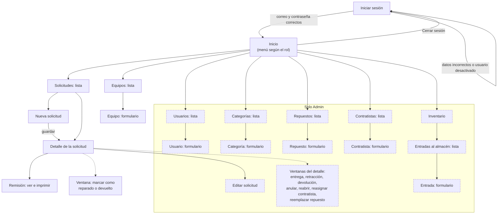

# Diseño UI/UX de FacturApp

Pantallas de la **fase 1**. El rol "usuario" del sistema es la **Oficina radicadora**. Las referencias HU corresponden a `02-requisitos.md`, y las rutas de cada pantalla con sus endpoints están en `04-arquitectura-api.md`, sección 4.3.

## 1. Inventario de pantallas

### 1.1 Admin (20 pantallas y 8 ventanas)

| # | Pantalla | Qué se hace | HU |
|---|---|---|---|
| 1 | Iniciar sesión | Escribir el correo y la contraseña | HU-01 |
| 2 | Inicio | Ver las opciones del rol en el menú; desde el menú se cierra sesión | HU-02, HU-03 |
| 3 | Usuarios: lista | Ver los usuarios y activarlos o desactivarlos | HU-09, HU-10 |
| 4 | Usuario: formulario | Crear un usuario (con contraseña inicial temporal) o editarlo | HU-07, HU-08 |
| 5 | Categorías: lista | Ver las categorías y activarlas o desactivarlas | HU-12 |
| 6 | Categoría: formulario | Crear o editar una categoría | HU-12 |
| 7 | Repuestos: lista | Ver el catálogo (sin stock) y activar o desactivar | HU-13 |
| 8 | Repuesto: formulario | Crear o editar un repuesto: código, nombre, categoría y unidad | HU-13 |
| 9 | Contratistas: lista | Ver los contratistas y activarlos o desactivarlos | HU-14 |
| 10 | Contratista: formulario | Crear o editar un contratista: cédula o NIT, nombre y teléfono | HU-14 |
| 11 | Equipos: lista | Ver las neveras registradas | HU-15 |
| 12 | Equipo: formulario | Registrar una nevera | HU-15 |
| 13 | Inventario | Ver el stock por repuesto: en almacén, apartado, disponible y en espera | HU-20 |
| 14 | Entradas al almacén: lista | Ver las entradas y retractar una con motivo | HU-19, HU-32 |
| 15 | Entrada: formulario | Registrar la mercancía que llega | HU-19 |
| 16 | Solicitudes: lista | Ver todas las solicitudes con su estado | HU-18 |
| 17 | Nueva solicitud | Elegir equipo, contratista, fecha y repuestos con cantidad | HU-17 |
| 18 | Detalle de la solicitud | Ver lo solicitado, entregado y pendiente, las remisiones y la línea de tiempo | HU-18, HU-22 |
| 19 | Editar solicitud | Cambiar una solicitud sin entregas | HU-34 |
| 20 | Remisión | Ver e imprimir la remisión, con espacio para la firma | HU-24 |

**Ventanas dentro del detalle de la solicitud** (formularios cortos o confirmaciones, RNF-09):

| Ventana | Qué se hace | HU |
|---|---|---|
| Registrar entrega | Escribir las cantidades a entregar | HU-21 |
| Retractar entrega | Escribir el motivo, junto a cada remisión | HU-31 |
| Registrar devolución | Elegir el repuesto y la cantidad devuelta | HU-33 |
| Marcar como reparado o devuelto | Confirmar, y escribir el motivo si es devuelto | HU-23 |
| Anular solicitud | Escribir el motivo | HU-34 |
| Reabrir solicitud | Escribir el motivo | HU-35 |
| Reasignar contratista | Elegir un contratista activo | HU-36 |
| Reemplazar repuesto | Elegir el repuesto nuevo para la fila sin stock | HU-37 |

### 1.2 Oficina radicadora (8 pantallas y 1 ventana)

| # | Pantalla | Qué se hace | HU |
|---|---|---|---|
| 1 | Iniciar sesión | Escribir el correo y la contraseña | HU-01 |
| 2 | Inicio | Ver solo las opciones de su rol; desde el menú se cierra sesión | HU-02, HU-03 |
| 3 | Equipos: lista | Ver las neveras registradas | HU-15 |
| 4 | Equipo: formulario | Registrar una nevera | HU-15 |
| 5 | Solicitudes: lista | Ver todas las solicitudes con su estado | HU-18 |
| 6 | Nueva solicitud | Elegir equipo, contratista, fecha y repuestos con cantidad | HU-17 |
| 7 | Detalle de la solicitud | Ver la solicitud, lo entregado y lo pendiente, sus remisiones y la línea de tiempo, sin los botones del Admin | HU-18, HU-22 |
| 8 | Remisión | Ver e imprimir la remisión | HU-24 |

**Su única ventana:** "Marcar como reparado o devuelto" (HU-23).

### 1.3 Pendientes y fase 2

- **Cambiar contraseña (PA-37, sin respuesta):** si el cambio obligatorio de contraseña pasa a la fase 1, se agrega una pantalla para ambos roles, que se abre justo después del login cuando la contraseña es temporal (HU-05).
- **Fuera de este inventario, por ser de la fase 2:** cambiar la propia contraseña, la vista de Oficina para el Admin, el resumen de inicio, los filtros, el historial por equipo, los movimientos de inventario, la remisión en PDF y los reportes.

## 2. Mapa de navegación

**Cómo leer el mapa:**

- **Flechas continuas:** se pasa de una pantalla a otra.
- **Flechas punteadas:** abren una ventana dentro del detalle de la solicitud.
- **Recuadro "Solo Admin":** pantallas que la Oficina radicadora no ve en su menú. Si escribe la dirección a mano, vuelve a Inicio con el mensaje "No tiene permiso para ver esta página." (HU-03).
- **Desde cualquier pantalla:** si la sesión vence o el usuario es desactivado, vuelve a "Iniciar sesión" con el mensaje que corresponde (HU-02, `04-arquitectura-api.md`, sección 5.3).
